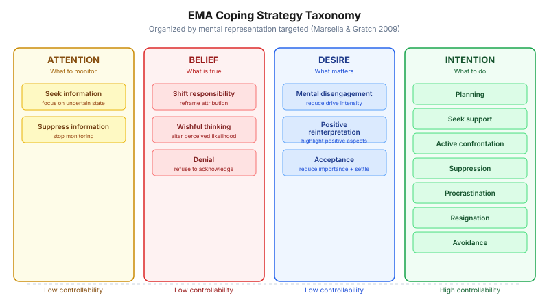
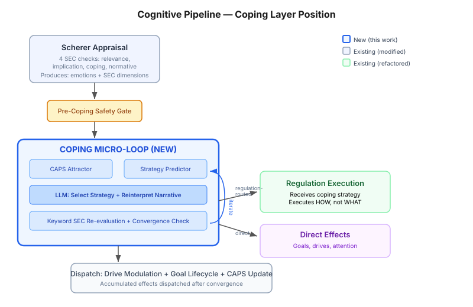
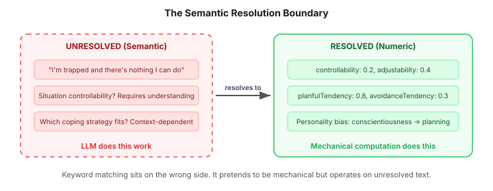

# The Missing Middle: Why Agents Need Coping, Not Just Feelings and Filters

*Continues the cognitive pipeline work from [The Gap Between Feeling and Acting](2026-11-04-mdp01-the-gap-between-feeling-and-acting.md). That entry covered emotion regulation — Gross's process model, the five strategy families, the design decision to go LLM-first for quality. This entry covers what sits between appraisal and regulation: coping.*

A previous session built the regulation layer. Characters could now suppress anger, reappraise anxiety, deploy attention away from a threat. Ten strategies, personality-driven selection, fatigue tracking. It worked. Characters with different Big Five profiles regulated differently, and the eval scores showed it.

But something was wrong.

A character would appraise a situation — detect a threat, compute high fear intensity — and immediately jump to regulation. "I should reappraise this." No deliberation. No cognitive processing of what the threat actually meant for them. No moment of "can I control this?" leading to a qualitatively different response than "I can't control this." The pipeline went from feeling to filtering with nothing in between.

That gap has a name. Lazarus and Folkman called it coping.

## What Coping Actually Is

The word gets used loosely. In clinical psychology it means something specific: the cognitive and behavioural effort to manage demands that exceed your resources (Lazarus & Folkman 1984). Not manage the feeling — manage the situation. Coping is what happens between "I'm afraid" and what you do about it.

Lazarus originally distinguished two modes: problem-focused coping (fix the situation) and emotion-focused coping (change how you feel about the situation). Later, he admitted this led to "an oversimple conception of the way coping works." He was right. Denial is emotion-focused. So is positive reinterpretation. But denial leads to deteriorating situations, while positive reinterpretation often leads to better outcomes. Lumping them together because they both target emotions misses everything that matters.

Marsella and Gratch (2009) built EMA — EMotion and Adaptation — a computational model that takes Lazarus seriously. Instead of two categories, they organise coping strategies by what mental representation they modify:

Sixteen strategies. Four categories. Each operates on a different part of the agent's interpretation of their situation. Attention strategies change what you monitor. Belief strategies change what you think is true. Desire strategies change what matters to you. Intention strategies change what you plan to do.

This is not academic taxonomy for its own sake. The categories have direct computational consequences. A belief strategy like "wishful thinking" modifies the agent's narrative interpretation of the situation — it literally changes the text the appraisal system evaluates. An intention strategy like "planning" creates a new goal in the goal lifecycle. A desire strategy like "acceptance" reduces the drive intensity for the threatened axis. Different mental representations, different data structures, different downstream effects.

## The Resolution That Mattered

The temptation was to simplify. Three modes — approach, reframe, avoid — would be easier to implement and conceptually cleaner. We considered it for about ten minutes.

The problem is resolution mismatch. The appraisal layer already runs four SEC checks producing multiple dimensions. The regulation layer already has ten strategies. Putting a three-mode bottleneck between two high-resolution systems loses exactly the information that makes characters feel different from each other.

A highly conscientious character doesn't just "approach" a problem. They plan. They seek instrumental support. They confront. These are distinct strategies with distinct personality correlations and distinct computational effects. Collapsing them into "approach" collapses the personality differentiation that the entire architecture exists to produce.

So we went full EMA. Sixteen strategies. Full resolution.

## The Architectural Surprise

The design process surfaced something we didn't expect: coping and regulation are not separate systems. They are the same system at different levels of abstraction.

EMA's coping strategies overlap significantly with Gross's regulation strategies. Positive reinterpretation is COGNITIVE_CHANGE. Avoidance is SITUATION_SELECTION. Mental disengagement is ATTENTIONAL_DEPLOYMENT. Seek support is SOCIAL_SUPPORT_SEEKING. The two taxonomies independently converged on the same territory from different theoretical traditions.

Running both as independent selectors would produce conflict — two systems fighting over the same decision space. The resolution: coping subsumes regulation. Coping selects WHAT to change. Regulation executes HOW to change it.

This means EmotionRegulationGenerationPhase no longer independently selects a strategy. It receives the strategy from the coping layer and executes it — assessing effectiveness, tracking fatigue, producing the experiential narrative. The regulation infrastructure stays; the selection authority moves upstream.

## The Reappraisal Loop

EMA models coping as continuous, not one-shot. You try planning. If the situation is uncontrollable, planning fails — the reinterpreted narrative still reads as threatening. So you try something else. Maybe acceptance. Maybe denial. Maybe you shift responsibility.

Our implementation models this as an intra-tick micro-loop. Appraise → select coping strategy → LLM reinterprets the situation narrative → keyword SEC checks re-evaluate the reinterpreted narrative → if emotion intensity is still above threshold, iterate.

The key insight is what feeds back. EMA's original model uses a structured plan representation — symbolic goals, beliefs, intentions manipulated as data structures. In our LLM-based architecture, "how the character sees the situation" is naturally text. The LLM transforms the narrative. The mechanical SEC checks evaluate the transformed text. If "positive reinterpretation" transforms "I'm trapped and helpless" into "I have options I haven't considered," the keyword-based controllability check detects more agency words and scores higher controllability. That changed controllability may make different coping strategies viable on the next iteration.

This is the semantic resolution boundary in practice.

## The Boundary That Explains Everything

We discovered a principle during this design that explains why some parts of the cognitive pipeline work well mechanically and others don't.

Keyword-based approaches consistently fail for coping. Counting "can" and "able" versus "trapped" and "stuck" doesn't capture whether a situation is actually controllable. The existing CopingCheck did exactly this, and it produced dimension values that had no meaningful relationship to the narrative's actual meaning.

But RegulationStrategyPredictor — which operates on numeric values like reappraisalCapacity (0.72) and suppressionCapacity (0.45) — works well. It compares personality scores against thresholds. Same computation, different inputs, different outcomes.

The difference: the predictor operates on values where the semantic work is already done. Someone already extracted meaning and resolved it to a number. The keyword checker operates on raw text and pretends the semantic work isn't necessary.

This gives us a clear rule: LLM handles semantic resolution. Mechanical computation operates on the resolved values. Keyword matching sits on the wrong side of this boundary — it pretends to be mechanical but operates on unresolved text.

The coping system follows this principle explicitly. The LLM selects the coping strategy and produces the reinterpreted narrative (semantic work). The CopingStrategyPredictor operates on personality scores and controllability values to bias the selection (mechanical work on resolved values). The keyword SEC checks evaluate the reinterpreted text — they work because the LLM has already done the semantic heavy lifting, and the keywords detect signal words in the resolved output.

## What Personality Does

Connor-Smith and Flachsbart (2007) ran a meta-analysis of Big Five personality traits and coping strategies. The correlations are moderate but consistent:

- Conscientiousness → problem-focused engagement (r = .21). Planful people plan.
- Neuroticism → disengagement and avoidance (r = .25). Anxious people avoid.
- Openness → positive reinterpretation (r = .11). Curious people reframe.
- Agreeableness and Extraversion → social support seeking (r = .11, .14). Social people seek help.

We encode these as CopingDefaults — a record derived from Big Five personality scores via the CognitiveDerivationEngine, following the exact same pattern as RegulationDefaults. The CopingStrategyPredictor uses these defaults to bias strategy selection: filter by controllability first (high control → intention strategies, low control → belief/desire strategies), then personality resolves ties among viable strategies.

The predictor doesn't decide. It biases. The LLM makes the final selection with full situational context. When personality signal is strong and controllability is clear, the predictor pins the strategy with high confidence. When signals are mixed, it yields. Same hybrid pattern as the regulation pipeline, but now at the right level of abstraction.

## What This Changes for Characters

Before this work, a character encountering a threat would:
1. Appraise → fear (high intensity)
2. Regulate → suppress fear (personality-selected strategy)
3. Act → behaviour reflecting suppressed fear

After this work, the same character will:
1. Appraise → fear (high intensity)
2. Cope → "Can I control this?" → If yes: plan a response → reinterpret situation as manageable → fear intensity drops through reinterpretation → If no: disengage from the threatened drive → accept the situation → fear transforms to resignation
3. Regulate → execute the coping-selected strategy (the cognitive transformation already happened)
4. Act → behaviour reflecting how they coped, not just that they regulated

The difference is cognitive depth. Regulation filters the emotion. Coping processes the situation. A character who plans their way out of trouble feels qualitatively different from one who denies the problem exists, even if both end up at the same regulated intensity. That difference — the "how did you get here" quality — is what makes characters feel like people rather than state machines.

## References

- Marsella, S. & Gratch, J. (2009). EMA: A process model of appraisal dynamics. *Cognitive Systems Research*, 10(1), 70-90.
- Lazarus, R.S. & Folkman, S. (1984). *Stress, Appraisal, and Coping*. Springer.
- Connor-Smith, J.K. & Flachsbart, C. (2007). Relations between personality and coping: A meta-analysis. *Journal of Personality and Social Psychology*, 93(6), 1080-1107.
- Gross, J.J. (1998). The emerging field of emotion regulation: An integrative review. *Review of General Psychology*, 2(3), 271-299.
