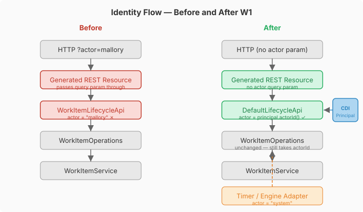

# Identity at the Gate

The playbook language direction review surfaced something I should have caught earlier: WorkItems — the human task layer that governance decorators compile down to — was taking the actor's identity from a query parameter. `?actor=alice` on the HTTP request was enough. No authentication check, no principal derivation, no verification that the caller was who they claimed to be.

This matters beyond the obvious security argument. The playbook direction (LD-5) says governance decorators — `confirm:` and `approve:` — compile to engine gates, and engine gates are delivered as WorkItems. If work doesn't verify who claims or completes them, the governance language is unenforceable end to end. A `confirm: second-holder` annotation on a payment step means nothing if any HTTP client can claim that work item by typing `?claimant=second-holder` in the URL.

## What was actually wrong

Two findings from the review:

**W1:** `WorkItemLifecycleApi` — the user-facing SPI — takes `String actor` and `String claimant` as method parameters. The platform annotation processor maps these to `@QueryParam` in the generated REST resource. The caller picks the identity.

**W2:** `WorkItemService` doesn't check whether the claimant is in the work item's candidate users or groups, and doesn't verify the actor is the assignee on lifecycle transitions. Even with real identity, the door is open.

This session fixed W1. W2 is next — it's a different kind of problem (authorization logic, not identity source) and needs its own design pass.

## The layer separation

The fix was straightforward once I saw the layer boundary clearly. CaseHub Work has two identity paths:

**User path** — a human acting through REST or GraphQL. Identity comes from the authenticated security context, mediated by Quarkus CDI's `CurrentPrincipal`. This is the path where `?actor=` was being trusted and shouldn't have been.

**System path** — timers, the engine adapter, the qhorus bridge. These call `WorkItemOperations` directly and legitimately specify an actor ID like `"system"` or a specific agent reference. No request scope, no authenticated principal — they're internal machinery.

The two paths already hit different interfaces. User requests go through `WorkItemLifecycleApi` (the `@McpDomain`-annotated SPI that generates REST endpoints). System operations go through `WorkItemOperations` directly. I confirmed this by grepping every casehub repo — no external caller touches the lifecycle SPI. The engine repo's `InboundWorkItemBridge` only calls `createInTenantContext()`.

So the fix: remove `String actor` / `String claimant` from every method on `WorkItemLifecycleApi`, `WorkItemQueueStateApi`, and `BulkOperationRequest`. Inject `CurrentPrincipal` in the three implementation classes. Use `currentPrincipal.actorId()` when calling down to `WorkItemOperations`, which keeps its parameters unchanged.

The generated REST resource drops `@QueryParam("actor")` and `@QueryParam("claimant")` automatically — the annotation processor has nothing to map when the unannotated String parameters disappear from the SPI. No code generator change needed.

## Why the gap existed

The pattern wasn't negligent — it was premature. The SPI was designed as a thin mapping layer between REST endpoints and service operations. Actor identity was a parameter because the REST resource passed it through, and the service needed it. The question "where should this parameter come from?" was deferred in favour of "make it work." The annotation processor already resolves `@ContextParam("tenancyId")` from `CurrentPrincipal.tenancyId()` — the principal was right there, used for one field, ignored for the one that mattered more.

Pre-release stage makes this a clean break. The request records (`FaultRequest`, `ObsoleteRequest`, `CompensateRequest`) lost their `actor` fields outright. `BulkOperationRequest` lost `actorId`. No deprecation, no backward compatibility shim.

## What comes next

W1 fixes identity source. W2 fixes authorization — verifying the authenticated principal actually has the right to perform the action. That means:

- **Candidate check on claim (#425):** The claimant must be in `candidateUsers` or a member of a `candidateGroup` when those fields are non-empty. The exclusion policy check is already there; the inclusion check is missing.

- **Assignee check on transitions (#426):** `start`, `complete`, `reject`, `suspend`, `resume`, `release` should verify actor equals assignee. The pattern already exists in `acceptDelegation` and `declineDelegation` — it just wasn't applied to the other transitions.

Both of these build on the principal being real, which is what this session delivered. With `?actor=mallory` gone, adding `if (!principal.actorId().equals(item.assigneeId()))` actually means something.

The governance chain is: playbook decorator → engine gate → work item → human action → verified identity → checked authorization. After this session, the identity link is solid. Authorization is next.
