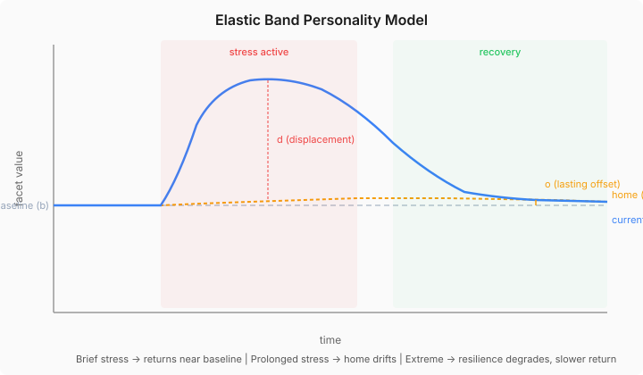

# The Elastic Band: Personality That Bends Under Pressure

*Continues the personality pipeline work from [The Missing Middle](2026-11-15-mdp01-the-missing-middle.md). That entry covered coping strategies — the sixteen EMA modes and why full resolution beats collapsing into three buckets. This entry covers what happens to the personality itself when a character stays under pressure.*

The personality pipeline produces cognitive defaults from PID-5 facets. Anxiousness shapes appraisal weights. Callousness dampens trust formation. Impulsivity degrades working memory span. These are static values derived once from the character's baseline personality profile, and they produce good differentiation — different characters genuinely think and act differently.

But a character under sustained stress doesn't just cope differently. Their personality shifts. The cautious analyst becomes rigid under threat. The warmly collaborative caregiver starts enabling rather than supporting. The creative risk-taker spirals into obsessive self-validation.

The existing architecture had no mechanism for this. CAPS settled behavioural attractors from situational inputs — fight, flight, freeze — but nothing interpreted those attractors as personality-level shifts. The character's PID-5 facets stayed constant regardless of what was happening to them. Appraisal weights didn't change, trust formation rates didn't shift, search budgets didn't narrow. Stress affected what the character did, never who they were.

## The Design Question

The original issue (#712) proposed shadow archetypes — a narrative identity layer above CAPS that contextualises what a stress attractor pattern means for a specific character's archetype. A Creator under stress becomes a different kind of Creator. A Caregiver under stress becomes a different kind of Caregiver. The shadow archetype concept comes from Jungian analytical psychology via Pearson (1991), where each of the twelve archetype families has a characteristic degradation pattern.

The question was how to implement it. The obvious approach — an overlay that pops on during stress and pops off when it resolves — felt wrong. Personality change isn't discrete. It's a continuous stream of micro-adjustments. When you spend two weeks in a high-pressure environment, you don't snap back to your pre-stress self on the Friday evening. Some of the tension stays. And if you spend six months there, more stays — permanently.

## The Elastic Band

The model that emerged is physical rather than computational. Think of each personality facet as an elastic band. Normal state: the band sits at its resting length. Stress pulls it. The band stretches. Release the stress and it springs back — mostly.

Mostly.

If the stretch was brief, you'd never notice. If it was prolonged, the band doesn't quite return to where it was. And if it was extreme or repeated, the elastic itself degrades — the band gets less elastic, and the next stretch leaves a bigger permanent mark.



Three quantities per facet tell the whole story:

- **Displacement** (d) — how far the personality is pulled from home right now. Relaxes exponentially toward home when the stressor resolves.
- **Home offset** (o) — how far the resting position has drifted from the original baseline. Accrues slowly during exposure, decays slowly over months. This is lasting personality change.
- **Resilience** (r) — how elastic the band still is. Degrades with exposure load, recovers during rest, but repeated deformation lowers the floor permanently. Metal fatigue for personality.

The effective facet value at any moment is `current = clamp(baseline + offset + displacement)`. The CDE receives this value and derives cognitive defaults from it, oblivious to the situational machinery. No special cases, no mode flags, no "shadow mode" parameter. The same PID-5-to-cognition pipeline that works at baseline works under stress — it just receives different facet scores.

## Why One Model, Not Two

I initially reached for the overlay approach. A base personality plus a stack of situational modifiers, like graphics compositing layers. Claude built out the full design — composable overlays, opacity-weighted blending, bleed-through on deactivation. It was clean and testable.

But it was wrong. The user's insight was more fundamental: personality change isn't a fork and merge. It's a continuous stream. An overlay implies a discrete event — stress starts, overlay activates, stress ends, overlay deactivates, reconcile the bleed-through. Real personality doesn't work that way. A conversation that gradually turns confrontational doesn't have a moment where "stress mode activates." The personality is being pulled continuously, and the system needs to model that.

The elastic band is one model. There is no second copy, no overlay, no snapshot to reconcile. The same state vector evolves continuously, and the character's current personality is whatever it happens to be right now. The situational context changes what the state is being pulled *toward*, not how the state is *stored*.

## Detection: Evidence Times Mood, Not Evidence Plus Mood

The detector classifies five situational modes from CAPS mediating activations, situation input confidences, SEC appraisal dimensions, and mood. The key design decision: endogenous signals (mood, appraisal) are gains on exogenous evidence, not additive terms.

```
E = X · (1 + β · N)
```

A saturated negative mood with no situational evidence produces zero. `X = 0` implies `E = 0`, exactly. This is the structural guarantee that prevents mood lock-in — a depressed character doesn't stay permanently in stress mode just because their pleasure is low. There has to be actual situational evidence. Mood amplifies it, but can't substitute for it.

This follows from Bower (1981) and Forgas (1995, Affect Infusion Model): affective state amplifies the appraisal of congruent situational evidence. It doesn't create evidence where none exists.

## The Archetype Profiles

Each of the twelve archetype families gets a situational profile — a set of PID-5 facet deltas that define the direction of personality pull under stress, flow, and social context. These are grounded in Pearson's shadow archetype descriptions and expressed as concrete facet shifts:

| Archetype | Stress shift | What it looks like |
|---|---|---|
| Creator | Anxiousness +15, Emotional Lability +20, Grandiosity +10 | Obsessive self-validation, perfectionism paralysis |
| Caregiver | Emotional Lability +20, Anxiousness +15, Callousness −10, Withdrawal −15 | Martyrdom, boundary collapse, over-extension |
| Hero | Hostility +15, Grandiosity +20, Risk Taking +10 | Win-at-all-costs, dismissal of constraints |
| Sage | Withdrawal +20, Suspiciousness +15, Grandiosity +10 | Intellectual superiority, dismissive isolation |

The magnitudes are on the PID-5 0–100 scale (divided by 100 for runtime). Every one carries `provenance: estimated` — the directions come from archetype psychology literature, but the magnitudes are tuned by eval. The eval criterion isn't clinical correctness; it's behavioural coherence. Do characters feel more real under stress? Do different archetypes degrade differently? Those are measurable questions.

## What This Means in Practice

A Creator character with baseline Anxiousness 0.45 enters a threatening situation. The detector reads CAPS mediating activations, sees threat-related nodes above the calibrated noise floor, and computes a stress intensity of 0.7. The archetype profile says Anxiousness δ = +0.15.

The integrator pulls: `d ← d + 0.3 · (0.15 · 0.7 − d)`. The displacement moves toward 0.105. The effective Anxiousness becomes 0.45 + 0.105 = 0.555. The CDE re-derives cognitive defaults: appraisal fear weight increases. Search budget narrows. Reappraisal capacity drops.

The character doesn't know any of this happened. It just becomes harder for them to see the situation clearly, easier for them to fixate on the threat, less likely to find a creative way out. That's what anxiety does to cognition — not as a narrative instruction, but as a parameter shift that flows through the same machinery that always governed their thinking.

If the stress resolves after ten turns, the displacement relaxes back toward zero within hours. The home offset barely moves — 0.0001 on a 0–1 scale. Resilience drops by 0.01. The character is effectively unchanged.

If the stress continues daily for a month, the picture is different. Resilience drops to 0.57. Home Anxiousness drifts up by 0.07. The band no longer springs back as quickly between episodes. Even stress-free weekends leave a residual. This is a character who has been changed by their experience — measurably, through the same pipeline, without any special "chronic stress" flag.

## The Wall-Clock Grid

One implementation detail matters for correctness: the integrator runs on a wall-clock-aligned hourly grid. Fatigue, healing, and drift are computed at hour boundaries. The displacement relaxation uses exact exponential integrals. The result is that advancing the same history at five-minute intervals or seven-day intervals gives identical `o` and `r` values — the state doesn't depend on tick rate or how often consolidation runs.

This sounds like an implementation detail, but it's actually a design constraint. The spec's adversarial review caught it: if the slow dynamics (resilience, deformation) depend on how often the system advances them, then a character on a busy server and one on a quiet server evolve differently from the same experience. The wall-clock grid eliminates that.

## What Opens Up

The architecture handles more than stress. Flow states pull personality in the opposite direction — reduced Anxiousness, increased Risk Taking for a Creator. Social contexts pull along a third axis — competitive interactions amplify Grandiosity and Suspiciousness, collaborative ones reduce them. At most two modes contribute simultaneously (one affective, one social), and their deltas add.

The design also opens a path to biographical extraction (#1056). If the engram pipeline already extracts PID-5 facets from biographical evidence, it can extract character-specific shadow profiles the same way — "how do this character's facets shift under stress, based on their documented stress responses?" The archetype family defaults serve as priors; biographical evidence personalises them.

The prerequisite work (#1055) refactors how cognitive defaults are computed — separating resting defaults (for learning rules) from effective defaults (for behaviour). This prevents the transient personality state from corrupting the rates at which durable structures like trust relationships and CAPS weights evolve, while still allowing the experience produced under stress to be recorded faithfully. TESSERA (Wrzus & Roberts 2017) calls this the state-to-trait consolidation path: lasting change accrues from repeated states, not from transient modulation of the learning dynamics.

The elastic band model is simple enough to hold in your head, but it captures the phenomena that matter: temporary shifts under pressure, partial return, cumulative damage from repetition, and slow recovery. For cognitive agents that need to feel like they have inner lives, that's the missing piece between "this character has a personality" and "this character has been through something."
