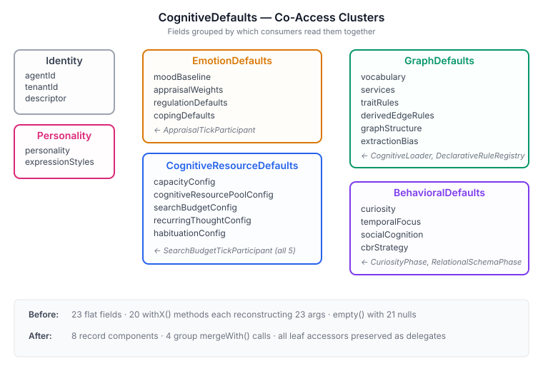

# The Record That Knew Too Much

*Continues the coping pipeline work from [The Missing Middle](2026-11-15-mdp01-the-missing-middle.md). That entry covered the design — why agents need coping, the EMA model, the strategy taxonomy. This entry covers what happened when the architecture started showing the strain.*

CognitiveDefaults started life as a simple record. Eight fields: agent ID, personality profile, mood baseline, a few cognitive style parameters. That was enough when the derivation engine produced a handful of personality-shaped values from disposition axes.

Then regulation arrived. Four new fields: reappraisal capacity, suppression capacity, redirect tendency, social regulation. Then cognitive resources: search budget, capacity config, resource pools, recurring thought thresholds, habituation. Then coping: five new coping tendency scores.

By the time I looked at it today, CognitiveDefaults had 23 record components. Every `withX()` method reconstructed all 23 arguments. The `empty()` factory passed 21 nulls plus two default values. The `deriveAndMerge()` method had 17 explicit-wins-over-derived field comparisons laid out sequentially. It compiled. It worked. But it had crossed the threshold where any new feature required touching a 23-argument constructor.

The issue had been filed during the coping work and deferred as "not the tipping point." It was time to pay the debt.

## Co-Access Tells You the Groups

The original issue suggested grouping by capability — "CognitionCapabilities containing regulationDefaults, copingDefaults, capacityConfig." That felt right at first glance. But I wanted data, not intuition.

Claude mapped every consumer of CognitiveDefaults across the neocortex codebase — 328 references, production and test. The question wasn't "what belongs together conceptually?" but "what gets read together at runtime?"

The access patterns told a different story from the original suggestion. `SearchBudgetTickParticipant` reads `searchBudgetConfig`, `capacityConfig`, `cognitiveResourcePoolConfig`, and `habituationConfig` — always together, never individually. That's not a "capability" group; it's a resource management cluster. Meanwhile, `moodBaseline`, `appraisalWeights`, `regulationDefaults`, and `copingDefaults` form the emotion processing pipeline: baseline mood → event appraisal → emotion regulation → coping strategies. Putting regulation and coping with capacity would have split the pipeline.

Four groups emerged from the data:

| Group | Fields | Why they cluster |
|-------|--------|-----------------|
| **EmotionDefaults** | mood, appraisal, regulation, coping | The emotion processing pipeline — baseline through coping |
| **CognitiveResourceDefaults** | capacity, pool, search budget, recurring thought, habituation | Resource management — always co-read by the search budget participant |
| **GraphDefaults** | vocabulary, services, trait rules, edge rules, graph structure, extraction bias | Knowledge graph structure and population rules |
| **BehavioralDefaults** | curiosity, temporal focus, social cognition, CBR strategy | Cognitive style and social reasoning parameters |

23 fields → 8. Each group got its own `mergeWith()` following the existing `PersonalityProfile` pattern. CognitiveDefaults kept every leaf-level accessor and `withX()` method as a delegate — 140+ test call sites continued compiling unchanged.

## The Silent Gap

The second piece of work was smaller but arguably more important.

`CopingState` accumulates three types of effects as the coping micro-loop runs: `GoalOperation`, `DriveModulation`, and `AttentionDirective`. When a character copes with a threat by planning, the state might accumulate a goal to create, a drive modulation to boost autonomy, and an attention directive to focus on the safety plan.

The dispatch method — `dispatchCopingEffects()` in `EmotionRegulationTickParticipant` — only sent goals to the `GoalProposalOrchestrator`. The drive modulations and attention directives were accumulated correctly, stored correctly, and then silently dropped. The pipeline had a gap.

This is the kind of bug that doesn't show up in unit tests because each component works fine in isolation. `CopingState.withAccumulatedDriveMod()` correctly accumulates. `DriveOrchestrator.recordAppraisalModulation()` correctly processes drive deltas. The gap is between them — nobody wires the output of one to the input of the other.

The fix was straightforward: inject `DriveOrchestrator` and `CognitiveAttentionMediator` into the regulation participant, convert the accumulated effects to their target formats, and dispatch. Drive modulations become a `Map<DriveAxis, Double>` (summing same-axis deltas) dispatched through the existing appraisal modulation pipeline. Attention directives become `AttentionSignal` entries with new `COPING_FOCUS` and `COPING_SUPPRESS` signal categories, queued through the attention mediator for prompt-time rendering.

## What This Enables

Neither of these changes adds visible behaviour. No character will respond differently tomorrow. But the remaining coping queue — CAPS attractor weight seeding (#1018), topology connections (#1019), prediction calibration (#921) — all depend on a CognitiveDefaults that can grow without pain and a dispatch pipeline that actually delivers the effects the coping loop produces.

The structural decomposition also makes the architecture legible to anyone reading the code for the first time. When you see `EmotionDefaults` as a record component, you know immediately that mood, appraisal, regulation, and coping belong together. When you see `CognitiveResourceDefaults`, you know the capacity and search budget configs are a cluster. The 23-field flat record communicated none of that — it was an append-only list of everything the derivation engine had ever needed to produce.

Infrastructure maturation isn't exciting. But a 23-field record that nobody wants to touch is how cognitive architectures stop evolving.
