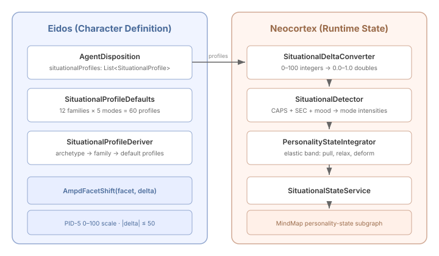

# Where Personality Lives

*Continues from [The Elastic Band](2026-11-17-mdp01-the-elastic-band.md), which covered the design — an elastic band model for situational personality modulation. This entry covers where the pieces actually go when you build it.*

The design gives you three things: a detector that reads situational context from CAPS and SEC dimensions, an integrator that pulls facets toward archetype-specific attractors, and a state machine that tracks displacement, home drift, and resilience degradation over time. What it doesn't tell you is which repository owns which piece. And the boundary between "who you are under stress" and "who you are right now" turns out to be the most consequential architectural decision in the whole feature.

## The Split

Two questions, two different answers, two different homes.

**What would change** — this is identity. A Caregiver under stress becomes more anxious and emotionally labile because that's what Caregivers do. A Hero under stress amplifies grandiosity and hostility because that's how Heroes degrade. These shift profiles are as much part of the character definition as their baseline personality scores. They belong in Eidos, the character description layer.

**What did change** — this is state. Right now, this Caregiver's Anxiousness is displaced by 0.12 from baseline, their resilience has dropped to 0.87, and home has drifted by 0.003 after three days of sustained pressure. This is transient, tenant-scoped, and ephemeral. It belongs in neocortex's MindMap, alongside memories and relationship overlays.

If you get this boundary wrong in either direction, things break. Put the shift profiles in neocortex and every game, every scenario, every test has to define them — or your characters degrade the same way regardless of archetype. Put the runtime state in Eidos and you lose tenant isolation — two players running the same character corrupt each other's personality state.

## Sixty Profiles

The Eidos side carries a table of archetype-family situational profiles: twelve families, five modes each, sixty entries. Each entry is a list of PID-5 facet deltas on the 0–100 AMPD scale — how much each facet shifts when that family enters that situational mode.

A Caregiver under stress: Anxiousness +15, Emotional Lability +12, Withdrawal −10. The anxiety and emotional flooding reflect the Caregiver's tendency toward martyrdom under pressure. The decrease in Withdrawal is the Caregiver-specific twist — they don't retreat, they over-extend. They lean in harder when they should pull back.

A Sage under stress: Withdrawal +15, Suspiciousness +12, Callousness +8. Intellectual superiority as a defence mechanism. The Sage retreats into abstraction, becomes dismissive of anything that doesn't fit their model, and stops tracking the emotional signals that would tell them they're wrong.

These directions come from Pearson's shadow archetype descriptions (1991) — the idea that each archetype family has a characteristic degradation pattern under sustained pressure. The magnitudes are model-derived, not empirically measured. Every entry carries `provenance: estimated` for exactly this reason. The eval criterion isn't clinical correctness; it's behavioural differentiation. Do different archetype families degrade differently, in ways that feel consistent with their identity?

The profiles are YAML, loaded once at application startup. They serve as family-level defaults. When a character's archetype resolves to a family (warrior → Hero, angel → Caregiver), the `SituationalProfileDeriver` fills in any modes the character definition doesn't already author. If a game designer has explicitly defined how their warrior handles stress, that authored profile takes precedence. The family default only fills gaps.

## The Bridge

The scale mismatch between the two sides is worth noting because it reveals a design constraint. Eidos uses integers on a 0–100 AMPD scale — the same scale as the baseline PID-5 facets. Neocortex uses normalised doubles on [0, 1]. The `SituationalDeltaConverter` divides by 100, mapping Eidos integers to neocortex doubles.

This isn't just a unit conversion. It's a type boundary. On the Eidos side, a delta of +15 means "shift this facet 15 points on the clinical scale." On the neocortex side, +0.15 means "pull the personality 15% of the full range toward the attractor." The same number, different semantics, different module, different test surface.

The converter also maps mode strings to enum values. Eidos uses lowercase strings (`"stress"`, `"social_collaborative"`) because YAML is the authoring format and character designers shouldn't need to know Java enum naming conventions. Neocortex uses `SituationalMode.STRESS` because the detector, integrator, and state machine need compile-time safety on mode identity. The converter sits at the boundary and translates.

## Persistence

The state service writes personality state to MindMap as flat properties — `facet.Anxiousness.displacement`, `facet.Anxiousness.homeOffset`, `facet.Anxiousness.resilience`, plus mode intensities, engagement flags, and the wall-clock cursor. Each agent gets a deterministic node name derived from a SHA-256 hash of its agent ID. Each tenant gets its own `personality-state` subgraph.

The property encoding is deliberately boring. No JSON blobs, no nested structures. Each value is a string that round-trips through `Double.parseDouble` or `Instant.parse`. When a consolidation cycle runs, the state service advances the integrator on the wall-clock grid and writes the updated properties back. If the node is missing (erased by another process, database corruption, whatever), it recreates it on the next persist rather than silently losing state.

This matters because personality state is the kind of data that falls between the cracks. It's not a memory — it's not retrieved or rendered. It's not a relationship overlay — it doesn't have a target agent. It's not cognitive metadata — it doesn't participate in search or salience. It's closest to mood state in the existing architecture: a continuously evolving internal quantity that affects cognition but isn't part of the knowledge graph. The `personality-state` subgraph type keeps it out of retrieval and rendering paths while still being durable across server restarts.

## The Appraisal Plumbing

The detector needs SEC appraisal dimensions to compute endogenous evidence — the mood-and-appraisal amplification that modulates how strongly a character enters a situational mode. But `LlmAppraisalStrategy.parseResponse` was computing those dimensions and then throwing them away. The parsed `dims` map was used for emotion mapping but never made it into the `AppraisalResult` record. A one-line fix: pass `dims` as the fifth constructor argument.

The detector also needs situation input activations from the CAPS classifier — the raw confidences before relational biasing adjusts them for interpersonal context. `AppraisalTickParticipant` was computing these internally but not exposing them. A new `currentInputActivations` accessor stores the pre-biasing activations as a map, keyed by CAPS node ID.

And `RelationalBiasing` had an unclamped output. With negative trust (distrust) and a negative scaling factor (betrayal sensitivity), the formula `confidence × (1 + trust × scale)` can exceed 1.0. Trust of −1.0, betrayal scale of −0.25, confidence of 0.9: `0.9 × (1 + 1.0 × 0.25) = 1.125`. A `Math.min(1.0, Math.max(0.0, ...))` clamp fixes the invariant that activation confidences live in [0, 1].

None of these were bugs in the existing system — the values were simply never consumed by anything that cared. The detector creates the first consumer.

## What This Opens

Batches 1 through 3 are the foundations: config, detection, integration, state persistence, profile resolution, delta conversion. The detector knows when a character is under stress. The integrator knows how to pull personality toward the stress attractor. The state service knows how to persist the result. The profiles tell the integrator which direction to pull.

What's missing is the wiring — the TERMINAL tick participant that orchestrates the per-tick cycle: advance state, build evidence, detect modes, resolve profiles, compute composite deltas, pull the integrator, publish to effective cognitive defaults, persist to MindMap, journal the entry. That's Batch 4, and it's gated on #1055, which refactors how cognitive defaults flow from resting personality to effective behaviour.

The gate is real. The situational personality participant needs to publish modulated facet scores to something that the CDE (Cognitive Derivation Engine) will read. Right now, the CDE reads from `CognitiveDefaultsRegistry`, which stores merged results with no provenance tracking and no tenant scoping. #1055 splits that into an immutable explicit layer (what the character definition says) and a tenant-scoped effective layer (what the character actually is right now). Without that split, the situational modulation would corrupt the resting personality or bleed across tenants.

The boundary between definition and state runs through the entire architecture. Getting it right here — profiles in Eidos, state in MindMap, conversion at the boundary — means the same pattern works for future modulation sources: biographical extraction of per-character shadow profiles, environmental conditioning from prolonged exposure to specific social contexts, even therapeutic intervention modelling. Each adds a new source of attractor profiles; the integrator, state machine, and persistence layer don't change.
