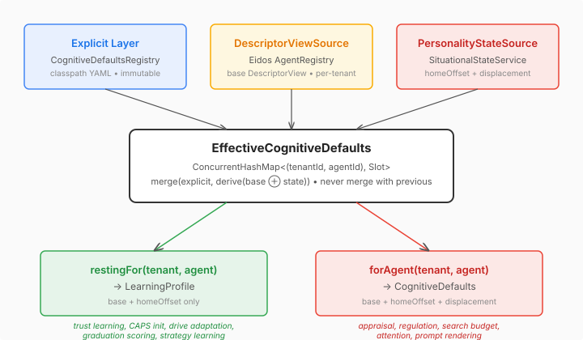

# The Type-Level Split

*Continues from [Where Personality Lives](2026-11-17-mdp05-where-personality-lives.md), which ended at the gate: how do modulated personality facets reach the cognitive pipeline without corrupting resting personality or bleeding across tenants?*

The gate was real. The situational personality participant needs somewhere to publish modulated facet scores — Anxiousness elevated by 0.12 under stress, Withdrawal suppressed by 0.08 in a collaborative context — such that the Cognitive Derivation Engine reads the shifted values on the next tick. The CDE doesn't know about situational modulation. It takes a `DescriptorView` with facet scores and derives appraisal weights, mood baselines, search budgets, regulation defaults. If the facets change, the downstream parameters change. That's the mechanism.

The problem is that the CDE's output goes to two fundamentally different places. Some consumers read it at tick time to shape behaviour — the appraisal system, the regulation strategy selector, the search budget calculator. These should see the stressed personality. The character IS anxious right now; that should colour how they appraise a threat, choose a coping strategy, or allocate attention.

Other consumers read it in consolidation phases that update durable state — trust formation rates in relational schema evolution, CAPS attractor weight learning, drive adaptation scaling, graduation scoring. These should NOT see the stressed personality. If the trust learning rate is modulated by transient anxiety, the character permanently learns distrust faster during every stress episode. The transient state has leaked into the learning dynamics, creating a feedback loop the TESSERA model explicitly prohibits.

## TESSERA's Constraint

Wrzus and Roberts (2017) formalized what personality psychologists had observed for decades: lasting trait change accrues from repeated states through slow processes. A single stressful episode doesn't change who you are. A year of daily stress might. The mechanism is the distinction between state (what you're experiencing now) and trait (what you've become through accumulated experience).

In the architecture, this maps to two values per facet. The **homeOffset** is the lasting deformation — accumulated slowly over many episodes, bounded by a maximum drift ceiling, subject to set-point decay when exposure ends. The **displacement** is the transient current shift — how far the personality is pulled right now by the active situational mode.

Resting personality includes the homeOffset but not the displacement. That's the personality as it has been shaped by experience — the trait. Effective personality includes both. That's the personality as it manifests right now — the state.

The whole point of TESSERA is that transient state reaches trait only through the bounded, slow homeOffset channel. If a learning rule reads effective values directly, it bypasses that channel. The character's trust formation rate would spike during every stress episode, the CAPS weight updates would oscillate with mood, and the graduation scorer would produce different thresholds for the same agent depending on when the consolidation phase happened to run.

## The Type System as a Safety Mechanism

I could have enforced this with documentation: "consumers that update durable state should call `restingFor`, not `forAgent`." That works until someone adds a new consolidation phase and calls the wrong method because both return something that looks like cognitive defaults.

Instead, `restingFor` returns a `LearningProfile` — a distinct type that wraps the resting `CognitiveDefaults` and exposes only the parameters learning rules actually need: `associativeReach`, `relationalComplexity`, `trustFormationRate`, `conflictInterpretation`, `copingDefaults`, `dispositionAxes`, `capacityConfig`, personality facets. These are the same fields, with the same names, as `CognitiveDefaults` — but they come from the resting derivation, not the effective one.

A learning rule takes `LearningProfile` in its signature. Not `CognitiveDefaults`, not an interface that could be either. `LearningProfile`. If someone tries to pass the effective defaults, it doesn't compile.

The classification of every consumer is documented and verified. Trust and role update, CAPS weight learning, drive adaptation, strategy learning, graduation scoring, personality evolution — all take `LearningProfile`. Appraisal, regulation, search budget, attention, prompt rendering — all take `CognitiveDefaults` from `forAgent`.

Fields that both paths need — `associativeReach` is the clearest example — appear in both types. The resting value in `LearningProfile` reflects the character's baseline cognitive reach. The effective value in `CognitiveDefaults` reflects that reach as modified by current situational state. Same field name, different derivation, different type, different consumer. A test could enumerate every accessor on both types and verify the classification against the spec.

## Tenant Scoping

The old `CognitiveDefaultsRegistry` keyed by `agentId` alone. Two tenants running the same character — two players with the same Sage in different games — would read and write the same defaults. The register method was a non-atomic read-copy-put on a volatile map: lost updates under concurrent writers.

`EffectiveCognitiveDefaults` keys by `(tenantId, agentId)`. Each slot is a `ConcurrentHashMap` entry with version-stamped compare-and-install. No blocking I/O inside the `compute` lambda — inputs are loaded outside the map, derivation happens outside the map, the lambda only checks whether the candidate's version stamps beat the incumbent's. Two concurrent loads for the same key both run to completion; the one with higher versions wins; the loser is discarded.

The version protocol has two counters. `baseVersion` is a per-key invalidation epoch incremented when the descriptor changes (tick hint, registry event, explicit reload). `stateVersion` is the situational state service's monotonically increasing publish counter. A stale load captured the old base version before an invalidation — its result installs with an outdated epoch and loses to any subsequent load. A concurrent state update and a concurrent load can only install in version order.

## The Migration

About 108 production references across 25 files in four modules — `cognition`, `mindmap-intelligence`, `cognitive-eidos`, `cognitive-index`. Each reference moved to one of three paths: `forAgent(tenantId, agentId)` for effective consumers, `restingFor(tenantId, agentId)` for learning consumers, or `agentIds(tenantId)` for consumers that enumerate agents.

Three consumers stayed on the old registry by design: `DeclarativeRuleRegistry`, `CognitiveLoader`, and `CognitiveProfileWatcher`. These read authored YAML — vocabulary, trait rules, derived-edge rules — that Eidos derivation never produces. They are deployment configuration, not runtime personality.

The bridge simplified to a single static method. `EidosCognitiveProfileBridge.toDescriptorView` translates an Eidos `AgentDescriptor` into the neocortex `DescriptorView` that the CDE consumes. The old `bridgeAll` and `registerFromDescriptor` methods — which merged derived results into already-merged registry entries, discarding provenance — are gone. `EffectiveCognitiveDefaults` handles the merge correctly: always `merge(explicit, derive(fresh inputs))`, never merge with a previous result.

## What This Opens

The situational personality participant can now publish modulated facets through `updateState`, and the resting/effective distinction flows automatically through every downstream consumer. When the Sage enters stress mode and their Withdrawal shifts by +0.15, the appraisal system sees elevated threat sensitivity and the regulation selector sees stronger redirect tendency — because those are derived from effective facets. But the trust learning rate and CAPS weight updates see the resting values, so the Sage's durable personality doesn't learn distrust faster just because they're currently stressed.

The same mechanism handles future modulation sources. Biographical shadow profile extraction, environmental conditioning from prolonged social context exposure, therapeutic intervention modelling — each adds a new source of facet deltas. The homeOffset/displacement decomposition, the resting/effective derivation, and the type-level consumer split don't change. The type system enforces the TESSERA constraint regardless of where the personality change originates.
