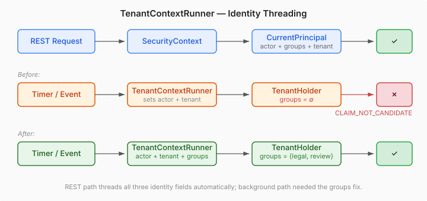

# The @DefaultBean That Multiplied

A human task system lives or dies by one question: who is allowed to do what? WorkItems — the casehub-work extension — now enforces this at two layers: who can *claim* an item (candidate eligibility, shipped earlier), and who can *act* on a claimed item (assignee guards, shipped this week). The second layer sounds obvious, but getting there surfaced a cross-cutting CDI problem that had been growing silently across twenty modules.

## Assignee guards: the authorization you forget to add

When a work item is claimed, it gets an assignee. Every subsequent lifecycle transition — start, complete, reject, suspend, resume, release — should verify that the actor requesting the transition is that assignee. Without this, any authenticated user who knows a work item ID can complete someone else's work, inject a resolution they didn't earn, or release an item back to the pool without the assignee's knowledge.

The implementation is a single private method:

```java
private void requireAssignee(WorkItem item, String actorId) {
    if (item.assigneeId() == null || !item.assigneeId().equals(actorId)) {
        blockedAuditService.record(item.id(), "TRANSITION_NOT_ASSIGNEE",
            actorId, "Actor '" + actorId + "' is not the assignee...");
        throw new IllegalStateException(...);
    }
}
```

Two things worth noting. The audit record uses `REQUIRES_NEW` transaction semantics — it persists even when the caller's transaction rolls back from the exception. The guard runs before the status check, not after. If you check status first, you reveal to a non-assignee what state the item is in. Authorization before business logic is the right order.

Not every lifecycle method gets the guard. Cancel, escalate, and delegate are excluded — a supervisor might cancel or escalate work they don't own, and delegation by definition transfers ownership. The scope boundary is explicit: eight methods guarded, six deliberately excluded.

## The @DefaultBean that multiplied

Here's the CDI problem that had been hiding. Quarkus `@DefaultBean` means "use this bean only if no other bean of the same type exists." It's how extensions provide sensible defaults — ship a no-op implementation, let consumers override with their real one.

WorkItems defined `NoOpGroupMembershipProvider` as `@DefaultBean`. Platform-core defined `MockGroupMembershipProvider` as `@DefaultBean`. Both implement `GroupMembershipProvider`. Both return empty results. Both are on the classpath in every test.

Two `@DefaultBean` beans of the same type with no non-default to disambiguate is an `AmbiguousResolutionException`. CDI can't pick between two beans that both say "use me only if nothing else exists" — they're both "nothing else."

The workaround had metastasised. The deployment processor had a `@BuildStep` that excluded the platform mock at build time. Twenty-one `application.properties` files each carried their own `quarkus.arc.exclude-types` line. Some excluded the platform mock, some excluded the work no-op, and two modules had their own `@ApplicationScoped` providers to override both defaults. Every new module that touched platform and work had to rediscover the exclusion dance.

The fix is to pick one and delete the other. Platform's mock is the canonical default — it ships with the platform, it's what every other casehub module expects. Work's no-op was a local workaround that became load-bearing. Delete the class, remove the build step, strip twenty-one exclusion entries, clean up orphaned comments. One hundred and twenty-five lines removed, zero added.

The lesson for multi-module Quarkus extensions: `@DefaultBean` works exactly once per type across the entire classpath. The moment two extensions independently decide to provide a "default" implementation of the same SPI, every downstream consumer inherits the ambiguity. If your extension depends on another extension that already provides a default, don't add your own — use theirs.

## Threading identity into background operations

`TenantContextRunner` establishes CDI request contexts for background work — timer jobs, cloud event handlers, federation receivers, anything that runs outside an HTTP request scope. It sets up `tenancyId` and `actorId` on a request-scoped `TenantHolder`, which a `TenantScopedPrincipal` delegates to.

What it didn't thread: groups.

`TenantHolder` already had `setGroups()` — added when the candidate eligibility checks landed. But `TenantContextRunner` never called it. Any background operation that claims a work item with `candidateGroups` would hit the eligibility check with empty groups and fail.

No callers exercise this path today. All claims arrive through REST (where the security-context principal carries groups) or the queue service (same). But the first background agent that tries to claim a candidateGroups-restricted item via `TenantContextRunner` would get `CLAIM_NOT_CANDIDATE` and no one would know why — because the groups are set, just not threaded.

The fix is a new four-argument overload that accepts `Set<String> groups`. The existing three-argument version delegates with `Set.of()`. The save-and-restore pattern already handles tenancy and actor; groups follows the same shape.



This is the kind of gap that's invisible until it matters. The candidate check worked. The holder supported groups. The runner just never connected them. Each piece was correct in isolation; the composition had a hole.

## Principal-based identity migration

The other half of this branch migrated `WorkItemClient` and all test suites from the old query-parameter identity model (`?claimant=X`, `?actor=Y`) to the generated principal-based API. The old `/workitems/{id}/claim` endpoints were deleted months ago but test code still referenced them. The migration touched every module that makes lifecycle calls — reports, AI, ledger, integration tests — plus the federation client. Each test now controls identity through a `MutableCurrentPrincipal` CDI bean instead of URL parameters.

The practical effect: identity flows through one mechanism everywhere. No more `?actor=` on some paths and `CurrentPrincipal` on others. The assignee guards work correctly because the same identity source feeds both the guard check and the lifecycle operation.

## Seven copies of the same bean

The migration left `MutableCurrentPrincipal` — the `@Alternative @Priority(200)` test bean that controls `CurrentPrincipal` identity — duplicated across seven modules. Each module had its own copy because Maven test classes can't be shared across modules without a dedicated artifact. Two of the copies were simplified versions missing the `crossTenantAdmin` field. If a test ever needed that field, it would fail silently — `isCrossTenantAdmin()` hardcoded to `false` with no setter.

A `casehub-work-test-support` module with Jandex indexing fixes this. One canonical class, seven `test`-scoped dependencies, seven deleted copies. The Jandex index is the detail that matters — without it, Quarkus CDI won't discover the `@Alternative` bean inside the dependency jar, and every test that injects `CurrentPrincipal` falls back to the platform's `@DefaultBean` instead of the mutable test bean. The tests would pass but identity control would be broken: `setActorId()` would have no effect. Jandex makes the bean visible to arc's bean discovery without requiring `beans.xml`.

## The ledger tests that weren't running

The ledger module had `<maven.test.skip>true</maven.test.skip>` in its pom — a workaround for the CDI ambiguity that the `@DefaultBean` fix resolved. Removing the skip surfaced three things: a stale SNAPSHOT dependency from the remote that lacked a recently-added column, an endpoint that moved from `/workitems/actors/{actorId}/trust` to the generated `/api/work/actor-trust/get-actor-trust/{actorId}`, and an API behavior change where posting an attestation for an unknown entry now returns 400 instead of 404. All fixable. Sixty-six tests, all green.

Skipped tests are invisible debt. The module compiled, it contributed to the reactor build, it looked healthy in CI. But its test suite hadn't run in weeks. The CDI fix landed in a peer repo and the work repo's tests didn't know because they were off. The longer tests stay skipped, the more fixes accumulate when they're turned back on.
