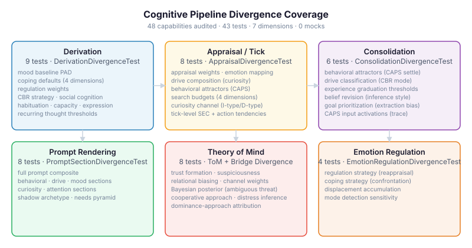

# Forty-Three Proofs That Personality Is Structural

*Continues from [The Attractor That Proved Personality](2026-11-19-mdp01-the-attractor-that-proved-personality.md).*

The last session proved that CAPS behavioral attractors diverge between personalities. One test, one layer. The cognitive pipeline has 48 capabilities that derive from personality — mood baselines, coping defaults, appraisal weights, regulation strategies, search budgets, curiosity channels, expression styles, recurring thought thresholds, graph structure biases, goal prioritization parameters. If any of those capabilities produce identical output for two different personalities given the same situation, that capability isn't doing its job.

I audited all 48. Six had tests. Forty-two had none. Then one more gap surfaced.

## The audit

The cognitive pipeline processes personality through six distinct stages. Each stage takes the personality definition — disposition axes, facets, weighted terms, goals — and produces measurably different behaviour.

**Derivation** is the base layer. `CognitiveDerivationEngine.derive()` transforms a `DescriptorView` into a `CognitiveDefaults` record — hundreds of parameters controlling every downstream component. Mood baseline PAD values, coping tendencies, regulation capacities, CBR retrieval modes, social cognition defaults, habituation thresholds, cognitive capacity limits, expression styles, recurring thought sensitivity. All derived deterministically from the personality definition. No tick, no pipeline, no state — pure function.

**Appraisal** is the first tick-level stage. After an observation hits the pipeline, the appraisal weights determine how urgently the agent treats it, how much relationship context matters, how quickly fear onset occurs. The search budget computation allocates cognitive breadth, depth, and laterality differently. The curiosity channel selector routes I-type (interest-driven, exploratory) or D-type (deprivation-driven, gap-filling) curiosity based on the agent's anxiousness facet score. These are runtime divergences — same observation, different processing.

**Consolidation** runs between ticks, during the sleep cycle. Graduated experience memories flow through CAPS — a 120-node network where activation propagates through personality-weighted connections until it settles into stable attractor basins. An open agent with adventure and curiosity drives settles into approach-oriented attractors. A cautious agent with suspicion and self-preservation drives settles into avoidance-oriented attractors. Same network architecture, different wiring, different settling.

**Prompt rendering** is where divergence becomes visible. Each prompt section — mood, drives, curiosity, attention, behavioral attractors, needs — renders differently because the upstream state it draws from already diverged. The full rendered prompt for two agents given identical observations reads as if written for two different people. Because it was.

**Theory of mind** determines how agents model each other. Trust formation rate — how quickly an agent moves from cautious to trusting — is derived from the disposition axes. Suspiciousness facet scores scale how much weight threat evidence receives. Relationship biases determine how prominently relational context features in the agent's extraction of meaning from observations.

**Emotion regulation** is the most consequential divergence. Reappraisal capacity versus suppression capacity — an open agent reframes stressors, a cautious agent buries them. Confrontation tendency versus avoidance tendency — the coping strategy selection when under pressure. The anxiousness and emotional lability facet gaps (open: 0.2, cautious: 0.85) guarantee that situational displacement accumulates faster for the cautious agent. Same stress, different regulatory response, different long-term personality trajectory.

## Consolidation results visible in the pipeline trace

The 42nd test proved attractors diverge during consolidation. But consolidation produced another signal the trace wasn't reporting: `capsInputActivations` — the raw input activations that the CAPS network settles from. `BehavioralSynthesisPhase` computed them during the sleep cycle, but `CognitionCore` didn't know the phase existed. The trace field was always empty.

The fix was two wiring changes in the test harness. First, hoist the `InMemoryCapsEngine` and `RuleBasedSituationClassifier` creation before `CognitivePipelineBuilder.build()` and wire the classifier through `pipelineBuilder.situationClassifier()` — matching production, where the classifier reaches both the consolidation phase and the `AppraisalTickParticipant`. Second, call `core.configureBehavioralSynthesis(bsp)` after constructing the phase — connecting the sleep cycle to the waking cycle so the trace can read back what consolidation produced.

The 43rd test asserts that CAPS input activations differ between OPEN and CAUTIOUS after consolidate + tick. The OPEN agent's adventure and curiosity drives map to approach-oriented input nodes. The CAUTIOUS agent's suspicion and self-preservation drives map to vigilance-oriented input nodes. Different drives, different CAPS input activations, different settling trajectories. The trace now reports all of it.

## Bayesian posteriors diverge — not just the config

The original theory-of-mind divergence tests checked derivation-level properties: does `trustFormationRate()` differ? Does the suspiciousness facet score differ? Those are config checks. They prove the derivation engine sets different values, but they don't prove the Bayesian inference engine produces different posteriors when given the same evidence.

`TheoryOfMindBridge.infer()` takes an `AppraisalResult` and a `TomPersonalityModulation` and returns a `TheoryOfMindPosterior` — three probabilities: positive, neutral, distressed. The modulation feeds into the Bayesian network through three pathways. Anxiousness shifts the threat prior (Bar-Haim et al. 2007 — anxious individuals over-interpret ambiguous stimuli as threatening). Callousness weakens the distress→avoidant coupling in the behaviour CPT (Blair 2005/2013 — reduced empathic coupling in callous-unemotional traits). Suspiciousness transfers approach evidence toward avoidant evidence (Fenigstein & Vanable 1992 — attributional bias).

I built `TomPersonalityModulation` values from the same OPEN and CAUTIOUS facets used throughout the divergence suite — anxiousness 0.2 vs 0.85, callousness 0.1 vs 0.4, suspiciousness 0.2 vs 0.7 — and fed the same appraisal scenarios through both.

The first test that failed taught me the most. I expected that for a mild threat with avoidant behaviour, the cautious agent would infer more distress. It inferred *less*. The cautious agent's callousness (0.4) weakens the distress→avoidant coupling in the CPT — avoidant behaviour is less diagnostic of distress for a callous observer. That effect outweighs the anxiousness-driven threat prior shift. The fix was to use neutral behaviour (ATTENDING) to isolate the anxiousness pathway from the callousness interference. The Bayesian network is doing exactly what the literature says it should: callousness makes avoidant behaviour look less alarming, even when the observer is anxious.

Four tests now exercise the bridge directly. Posteriors diverge on ambiguous appraisal. Cautious agents infer more distress from mild threat when behaviour is neutral. Open agents infer more positive from cooperative approach. Suspicious agents read approach-plus-dominance as more threatening than trusting agents do. All deterministic, all under 1ms.

## From derivation-level to tick-level assertions

The harness had a gap. The divergence tests for appraisal dimensions — SEC weights, drive composition, curiosity channels — all operated at the derivation level. They checked that `CognitiveDefaults.appraisalWeights()` differs between personalities, not that the pipeline produces different `PipelineTrace.appraisalResult()` after a tick. The difference matters: derivation proves the config is correct, tick-level proves the runtime uses it.

The gap existed because `CognitionConfig.all()` has `appraisalEnabled = false`. The appraisal participant's `tick()` method checks this flag and immediately returns. So even though the harness wired strategies through the pipeline builder, the participant never ran. `PipelineTrace.appraisalResult()` was always null.

The existing workaround — `withAppraisalResult("agent", result)` — creates a Mockito mock that returns pre-canned results. Useful for testing downstream consumers, useless for proving appraisal diverges. The mock doesn't run `tick()`. It returns whatever you told it to return, regardless of personality.

I added `withAppraisalEnabled(true)` to the harness builder. It does two things: enables the appraisal flag in `CognitionConfig`, and wires a `TestAppraisalStrategy` through `CognitivePipelineBuilder.appraisal()`. The strategy is rule-based — it computes SEC dimensions from the personality-derived `AppraisalWeights` (fear onset threshold → conduciveness, urgency weight → controllability) and derives action tendencies from disposition axes (cooperative → APPROACH, avoidant → AVOIDANCE). No NLP, no keywords, no LLM. The personality weights already carry the differentiation.

The pipeline builder creates a real `AppraisalTickParticipant`. When `tick()` runs, the participant calls the strategy, stores the result, and `PipelineTrace.appraisalResult()` is populated with personality-sensitive SEC dimensions. Same observation, different SEC dimensions, different action tendencies, different emotions — because the personality weights are different.

Two new tests prove it: `appraisalResultDivergesAtTickLevel` and `actionTendenciesDivergeAtTickLevel`. Both tick OPEN and CAUTIOUS agents with the same observation and assert the trace fields differ. These aren't derivation checks. They're pipeline checks — the full CognitionCore runs, the participant fires, the trace records the result.

## The OPEN/CAUTIOUS methodology

The test suite uses two synthetic personalities designed to maximise differentiation while remaining psychologically coherent.

**OPEN** — cooperative, moderate rule-following, bold risk appetite, high autonomy, cooperative conflict resolution. Low anxiousness (0.2), low emotional lability (0.2), low withdrawal (0.1), high risk-taking (0.8), low suspiciousness (0.2). Cognitive functions Ne (extraverted intuition) and Se (extraverted sensing). An agent that explores, engages, and trusts.

**CAUTIOUS** — independent, strict rule-following, conservative risk appetite, low autonomy, avoidant conflict resolution. High anxiousness (0.85), high emotional lability (0.8), high withdrawal (0.8), high suspiciousness (0.7), low risk-taking (0.2). Cognitive functions Si (introverted sensing) and Te (extraverted thinking). An agent that conserves, monitors, and mistrusts.

These aren't caricatures. The facet scores are drawn from the PID-5 (Personality Inventory for DSM-5) dimensional model — each score maps to a clinical dimension with empirical grounding. The dispositions use the five axes the derivation engine maps to cognitive defaults: social orientation, rule-following, risk appetite, autonomy, and conflict mode.

The key property: every derivation pathway that depends on personality should produce different output for these two profiles. If a capability produces identical results for OPEN and CAUTIOUS, the personality isn't reaching that capability — it's a gap in the pipeline.

## What the shared fixtures enable

`DivergenceFixtures` extracts the personality definitions, derivation calls, and harness builders into a shared utility class. The test classes don't construct personalities — they call `DivergenceFixtures.openDefaults()` and `DivergenceFixtures.cautiousDefaults()`. For tick-level tests, `pairedBuilder()` returns a pre-configured harness with both agents registered. For consolidation tests, `fullBuilder(store)` adds behavioral synthesis and CAPS.

The MindMap seeding — experience nodes, drive-intensity nodes, cognitive subgraph structure — is centralised in `seededCognitiveStore()`. The attractor comparison logic — stream attractors by category, compare strengths within tolerance — is `assertAttractorsDiverge()`. Two test classes were using identical 40-line blocks for this; now they call two methods.

This matters for maintenance. When a new personality facet is added to the PID-5 mapping, the fixture updates in one place and all 42 tests pick it up. When a new derivation capability is added, a new test method is a 10-line function calling the shared fixtures.

## What this proves

Forty-three tests, seven dimensions, every test deterministic, every test under 500ms, no LLM calls, no mocks. The suite proves that personality flows through every stage of the cognitive pipeline and produces measurably different output at each stage — from pure derivation through tick-level appraisal through Bayesian posterior inference through consolidation input activations.

The Bayesian ToM tests add something the derivation tests couldn't: they prove that personality modulation propagates through a probabilistic inference engine and shifts the posterior distribution. The callousness interaction is the clearest example — a single facet score changes which observed behaviours are diagnostic of distress. That's not a parameter check. That's a computational proof that personality shapes how agents model each other's mental states.

The tick-level appraisal tests add something the derivation tests couldn't: they prove that the full pipeline — `CognitionCore.tick()` through `AppraisalTickParticipant` through `TestAppraisalStrategy` — produces different SEC dimensions and action tendencies for different personalities. The same observation enters the pipeline, and the personality-derived weights route it through different appraisal pathways.

The implication for cognitive agent architecture: personality is not a prompt prefix. It is not a system message that says "you are cautious." It is structural — it determines the weights in the network, the thresholds in the regulators, the biases in the extractors, the priors in the Bayesian inference, the strategies in the coping system, the basins in the attractor landscape. Two agents with different personalities given the same observation will appraise it differently, regulate it differently, model each other differently, consolidate it differently, and act on it differently. Not because they were told to, but because their cognitive architecture routes information differently.

That's what the 48-capability audit and the 43-test suite exist to prove. And to catch the moment any refactoring, any new capability, any pipeline change breaks that guarantee.
